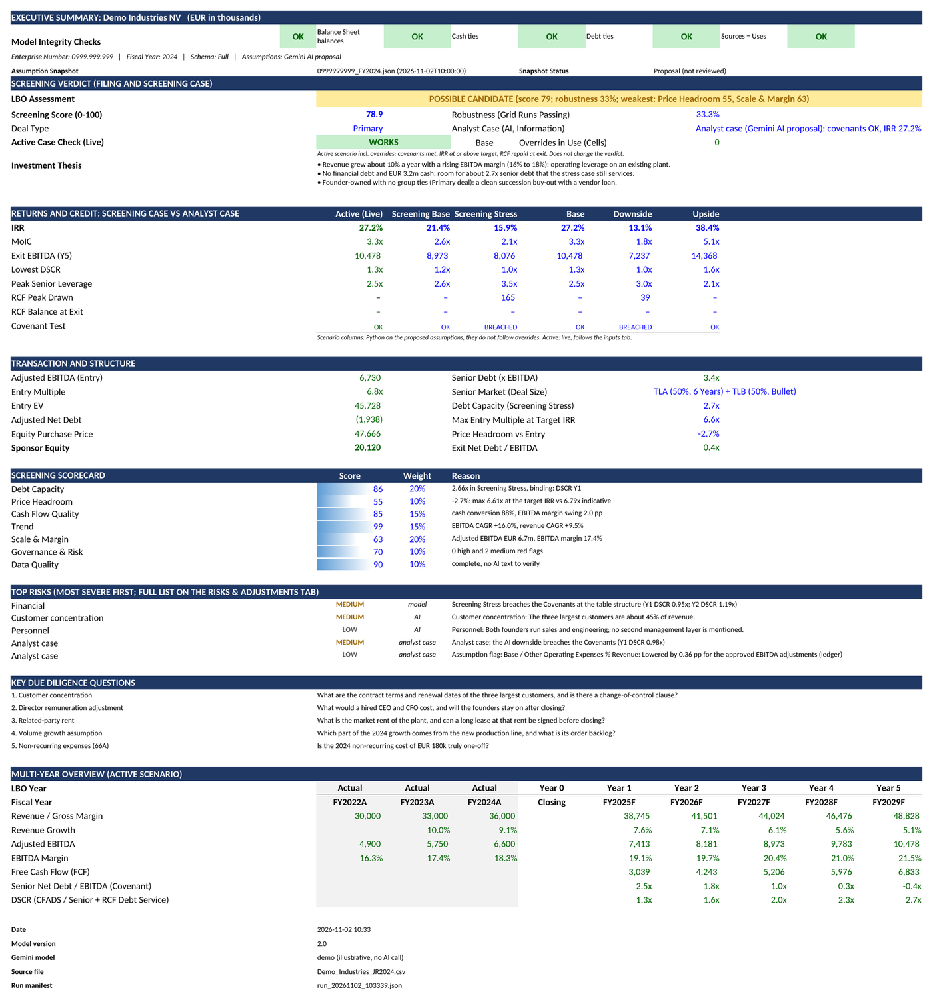
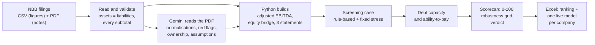
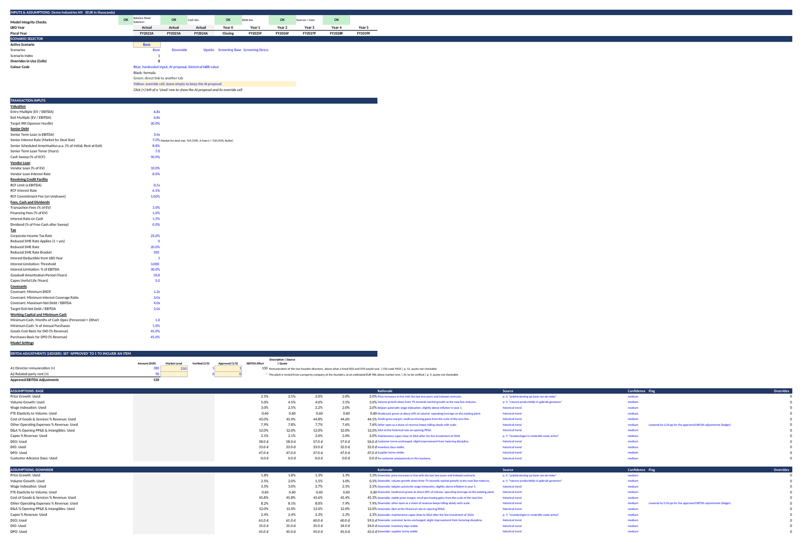
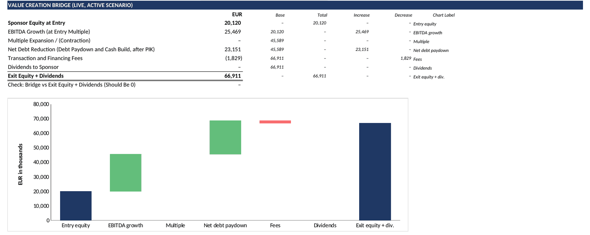
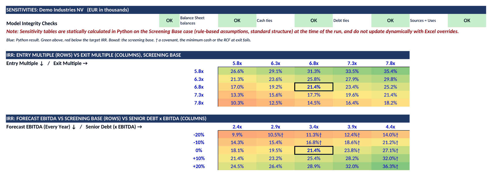
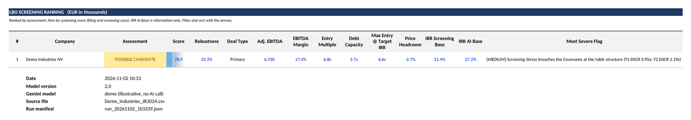

# Belgian SME LBO Screener 

[](https://github.com/SimonCode06/LBO_Project/actions/workflows/tests.yml)

**Screens private Belgian SMEs for leveraged buyout potential, straight from their filed annual accounts.**
Input: the annual accounts as filed with the National Bank of Belgium (NBB). Output: a ranked
overview of all companies and, per company, a live, formula-driven Excel model at investment committee
level: 3-statement model, LBO returns, debt capacity, sensitivities and a one-page verdict.



## The problem

M&A boutiques and private equity funds in Belgium spend hours screening small and mid-sized companies
that sit in no commercial database. An analyst downloads the annual accounts, retypes the figures
into Excel, reads the notes for one-off costs to normalise EBITDA, and only then judges whether the
company can carry an LBO. That is slow, error-prone and hard to compare across companies.

This tool does that first screen automatically and reproducibly: the figures come from the
structured NBB filing, an AI model reads the PDF for text only, and every number is calculated in
Python or in an Excel formula.

## What it does



1. **Read and validate.** The NBB CSV gives every account code of every fiscal year. The tool checks
   that the filing reconciles (assets = liabilities, every subtotal) and distinguishes a missing code
   from a zero.
2. **Read the text (AI).** Gemini reads the PDF of the annual accounts and returns structured
   building blocks only: proposed EBITDA adjustments, red flags, ownership and off-balance-sheet items,
   each with a page and a literal quote. Every quote is checked against the PDF; an amount with an NBB
   code is always taken from the CSV, never from the AI.
3. **Build the model (Python).** Adjusted EBITDA with an adjustment ledger the analyst approves line
   by line, a cash-free/debt-free equity bridge with minimum cash and an NWC peg, and a five-year
   3-statement LBO model: senior debt sized by deal size (bank loan, TLA/TLB or unitranche), RCF,
   PIK vendor loan, cash sweep, Belgian tax rules and bank covenants (senior net leverage, interest
   cover, DSCR).
4. **Judge (deterministic).** The verdict comes from the filing and a rule-based *screening case*
   with a fixed stress (EBITDA -20% in years 1-2, -15% in year 3, -10% in years 4-5), never from
   the AI forecast:
   - **Debt capacity:** the highest senior multiple at which the stress case meets every covenant in
     every year, keeps minimum cash and repays the RCF (found by bisection).
   - **Ability-to-pay:** the highest entry multiple at which the sponsor still earns a 20% IRR.
   - **Scorecard (0-100)** on debt capacity, price headroom, cash flow quality, trend, scale and
     margin, governance and data quality, each with a reason; plus an 18-run **robustness grid**.
   - **Verdict:** STRONG / POSSIBLE / WEAK candidate, NO-GO (with the reason), REVIEW or
     INSUFFICIENT DATA.
5. **Write Excel.** A ranking of all companies and one live workbook per company. Every forecast cell
   is a formula; an analyst can override any assumption and the whole model, the covenants and the
   value creation bridge follow.

## The company workbook

| Tab | What it holds |
|---|---|
| **Executive Summary** | One A4 page: verdict, score, robustness, deal type, a live check of the active scenario, investment thesis, returns by case, structure, scorecard, top risks, due diligence questions, five-year overview. |
| **Inputs & Assumptions** | Every input on one tab: scenario selector, transaction inputs, the EBITDA ledger with approval switches, and per scenario and driver the AI proposal, an override cell and the value used. |
| **3-Statement Model** | Income statement, balance sheet and cash flow statement, year by year, with integrity checks. |
| **LBO Analysis** | Equity bridge, sources and uses, debt schedule (interest on opening balances, no circularity), cash flow waterfall, covenants, returns, debt capacity, ability-to-pay and a live value creation bridge. |
| **Sensitivities** | IRR by entry and exit multiple, and by EBITDA (-20% to +20%) and senior debt. |
| **Risks & Adjustments** | Every red flag in a filterable table, the ledger and the qualitative notes. |

Formatting follows banking conventions: blue inputs, black formulas, green links to other tabs,
yellow override cells, EUR thousands with negatives in brackets, multiples as 0.0x.

| Inputs & Assumptions | Value creation bridge |
|---|---|
|  |  |



The overview workbook opens on a ranking of all companies:



## Design principles

1. **AI reads, Python calculates.** A language model never produces a number in the model. It
   proposes; Python and Excel formulas compute.
2. **The verdict is deterministic.** Same filing, same code, same verdict. AI assumptions are stored
   as snapshots, and the verdict uses the rule-based screening case, so a new AI run can never change
   a label. The AI forecast is shown next to it as the *analyst case*.
3. **Every figure is traceable.** Each AI item carries a page and a quote that is checked against the
   PDF; each run writes a manifest with the git commit, package versions and file hashes.
4. **Excel equals Python.** The workbook is rebuilt cell by cell from the same logic, and a test
   recalculates it (Excel on Windows, LibreOffice in CI) and compares every scenario with Python.

## Quick start

Requires Python 3.10 or later.

```
git clone https://github.com/SimonCode06/LBO_Project.git
cd LBO_Project
pip install -r requirements.txt
python main.py --demo
```

The demo runs a fictitious company (Demo Industries NV) end to end without an API key and writes the
overview and the company workbook to `output/demo/`. See [examples/demo](examples/demo/README.md).

## Running it on real companies

1. Download the annual accounts from the NBB Central Balance Sheet Office
   ([consult.cbso.nbb.be](https://consult.cbso.nbb.be)): for each company the CSV of three
   consecutive fiscal years and the PDF of the most recent one.
2. Put them in `input_pdfs/`, named `<Company>_JR<year>.csv` and `<Company>.pdf` (or
   `<Company>_JR<year>.pdf`).
3. Put a Gemini API key in `api_key.txt` or in the environment variable `GEMINI_API_KEY`. Without a
   key the tool still runs on the figures alone.
4. Run `python main.py`. Useful flags: `--vernieuw-assumpties` (ask the AI for new assumptions; the
   old snapshot is archived) and `--ijking` (write the score ranking with every component, to
   calibrate the scorecard).
5. Review the proposals: approve EBITDA adjustments in `assumpties/<number>_FY<year>_adjustments.json`
   (or with the switches in Excel) and mark an assumption snapshot as reviewed.

AI answers and assumptions are cached, so a second run costs no API calls.

## Tests

```
pytest
```

About 250 tests: the data layer (missing versus zero, full, abridged and micro schemas, broken fiscal
years), a regression baseline of the key outputs, every step of the verdict, the scorecard and its
calibration, debt capacity and ability-to-pay, quote checks, the workbook format, and a full
recalculation of the workbook (Excel through COM on Windows, LibreOffice headless in GitHub Actions)
compared with Python in every scenario. CI runs on every push.

## Limitations

- **Annual figures only.** No monthly data, seasonality or order book; the forecast starts from the
  last filed year.
- **Multiples are assumptions.** Entry multiples come from a size table in `config.py`, without a
  sector correction; real prices depend on the sector and the process.
- **Screening, not due diligence.** Tax, legal and quality-of-earnings points become questions, not
  conclusions. The scorecard is calibrated on a small set of companies against one analyst's ranking.
- **Manual input.** Filings are downloaded by hand; bulk access to NBB data is a paid service. Only
  the reader in `src/nbb_csv.py` would need a second source.
- **Text in English, code in Dutch.** All output is in English; function and variable names are
  Dutch.

## How I built this

I am a business economics student at Ghent University with an interest in corporate finance and
private equity. I designed this tool as a product: I defined the problem, the financial logic and
the decision rules, set the standards for the output, reviewed every step and calibrated the
scorecard against my own judgement of real companies. The code was written with Claude Code
(Anthropic) as the engineer, phase by phase, each phase on its own branch.

What kept it reliable:

- a written plan per phase, agreed before any code was written;
- a test for every rule, a regression baseline that must stay green, and a written reason in the
  commit whenever a number changes on purpose;
- an independent audit of the first working version, which led to the screening case, the debt
  capacity analysis and the scorecard;
- the Excel workbook reconciled against Python in every scenario on every push.

## Project structure

```
main.py                 entry point: reads input_pdfs/, writes output/
src/nbb_csv.py          NBB CSV reader and validation (missing vs zero, schemas)
src/ai_extraction.py    Gemini calls (text pass, assumptions, commentary)
src/tekst_schema.py     structured AI output and the quote check (with citaten.py)
src/normalisaties.py    EBITDA adjustment ledger
src/assumpties.py       forecast drivers, snapshots and the screening case
src/lbo_model.py        the LBO model in Python
src/structurering.py    debt capacity and ability-to-pay
src/scorecard.py        scorecard and robustness grid
src/vlaggen.py          structured red flags
src/calculations.py     the result table and the verdict
src/excel_model.py      the formula-driven company workbook
src/excel_export.py     the overview workbook
src/sensitiviteit.py    sensitivity tables
src/config.py           every parameter and threshold
src/labels.py           every text shown in the output
tests/                  the test suite
examples/demo/          the fictitious demo company
```

## Disclaimer

A screening tool for education and portfolio purposes. It is not investment advice. The demo
company is fictitious.
